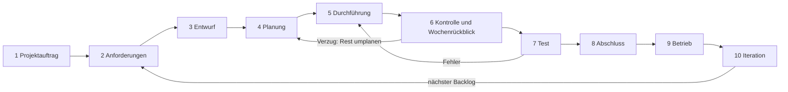
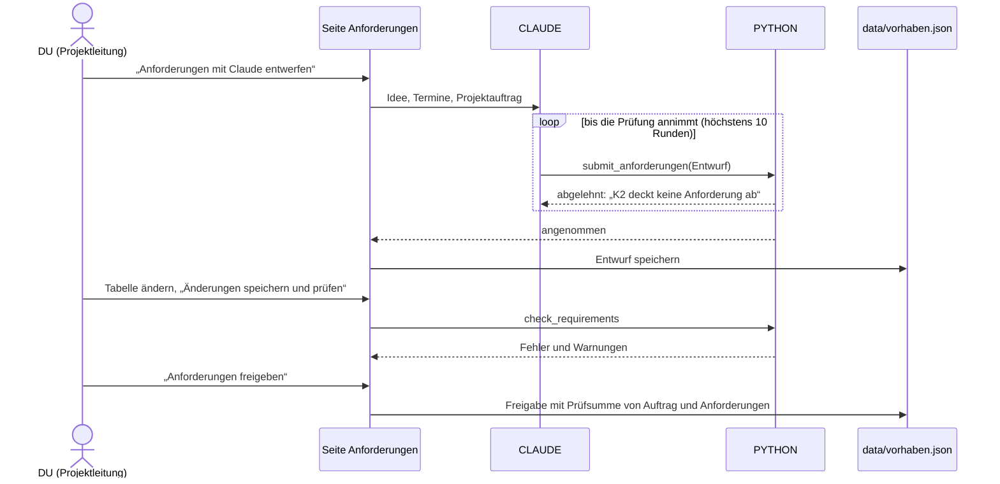

# Lebenszyklus eines Softwareprojekts im PM-Agent

Dieses Dokument beschreibt, wie der PM-Agent ein Softwareprojekt von der Idee bis zur nächsten
Iteration begleiten soll. Umgesetzt sind bisher die Phasen 1 bis 7 (Stand
16.11.2026). Die übrigen Phasen sind entworfen, aber noch nicht gebaut.

## Ein Prinzip für jede Phase

Jede Phase besteht aus denselben drei Teilen. So muss man das System nur einmal verstehen:

| Teil | Wer | Was |
|---|---|---|
| Ergebnis | **CLAUDE** entwirft | ein festes Datenformat (pydantic), eingereicht über ein Werkzeug (`tools.Submission`) |
| Prüfung | **PYTHON** prüft | feste Regeln, vor allem: Lässt sich jedes Ergebnis auf das Ergebnis der Phase davor zurückführen? Was nicht passt, geht mit Begründung an Claude zurück. |
| Freigabe | **DU** entscheidest | die Projektleitung ändert das Ergebnis und gibt es frei. Ändert sich danach etwas davor, gilt die Freigabe nicht mehr („seit der Freigabe geändert“). |

Fakten trägt der Mensch ein: Termine, Team, Fortschritt, Testergebnisse, Störungen. Claude
schreibt Entwürfe und Bewertungen, rechnet aber nie selbst. Jede Zahl rechnet Python.

Die Freigaben sind **weich**: Eine Phase darf übersprungen werden. Der Projektpfad über jeder
Seite zeigt sie dann gestrichelt mit „nicht freigegeben“, und was auf ihr aufbauen würde,
arbeitet ohne sie (zum Beispiel plant die Planung ohne Anforderungen wie bisher).

## Die Phasen

| # | Phase | Ergebnis | Prüfung durch Python | Stand |
|---|---|---|---|---|
| 1 | Projektauftrag | Ziel, Nutzen, Umfang und Nicht-Umfang, Beteiligte als Rollen, Erfolgskriterien K1 …, Rahmenbedingungen | eindeutige IDs der Erfolgskriterien | umgesetzt |
| 2 | Anforderungen (PRD) | Anforderungen R1 … mit User Story, Priorität Muss/Soll/Kann, Akzeptanzkriterien R1.1 …, zugehörigen Erfolgskriterien | jedes Erfolgskriterium abgedeckt; nur bekannte genannt; mindestens eine Muss-Anforderung | umgesetzt |
| 3 | Entwurf | Komponenten, Schnittstellen (Anbieter, Nutzer, Eingabe, Ausgabe, Fehler), Abläufe als Schritte | jeder Beteiligte eines Ablaufs ist eine bekannte Komponente; jede Schnittstelle kommt in einem Ablauf vor; jede Muss-Anforderung hat einen Ablauf. Das Sequenzdiagramm zeichnet Python aus den Schritten, nicht Claude. | umgesetzt (Design: [entwurf-design.md](entwurf-design.md)) |
| 4 | Planung | Aufgaben mit Aufwand, Zuweisung, Abhängigkeiten und den Anforderungen, denen sie dienen; je Projektwoche ein vorführbares Ergebnis | unbekannte Anforderung = Fehler; Anforderung ohne Aufgabe = Warnung; dazu Termine, Auslastung, Puffer; jede Projektwoche mit Arbeit hat eine Demo, deren Aufgaben bis Freitag fertig sind (Warnungen) | umgesetzt |
| 5 | Durchführung | Status, Ist-Stunden, Rest je Aufgabe; Statusbericht | jede Aufgabe im Verzug hat einen nächsten Schritt | umgesetzt |
| 6 | Kontrolle und Wochenrückblick | Plan/Ist, Prognose, Earned Value, Stand je Anforderung; Wochenrückblick: Demo gezeigt?, Ursache von Fehlern, Maßnahme | jede Aufgabe im Verzug hat eine Gegenmaßnahme; jede ausgefallene Demo eine Maßnahme | umgesetzt ([woche-design.md](woche-design.md)) |
| 7 | Test (Integrationstest und Fehlersuche) | Testfälle aus Akzeptanzkriterien und Schnittstellen, Ergebnisse, Fehler mit vermuteter Ursache | jedes Akzeptanzkriterium hat einen Testfall; jede Schnittstelle einen Integrationstest; jeder fehlgeschlagene Test einen Fehlereintrag | umgesetzt ([test-design.md](test-design.md)) |
| 8 | Abschluss | Abnahme je Anforderung (abgenommen oder zurückgestellt mit Grund), Abschlussbericht, Lessons Learned | kein offener schwerer Fehler; jede Muss-Anforderung abgenommen oder begründet | entworfen |
| 9 | Betrieb | Betriebshandbuch (Bereitstellung, Überwachung, Rücknahme), Störungen | jede Komponente hat Verantwortliche und Überwachung | entworfen |
| 10 | Iteration | nächster Backlog: zurückgestellte Anforderungen, offene Fehler, offene Maßnahmen der Rückblicke, Folgen von Störungen | jeder Eintrag nennt seine Herkunft | entworfen |

## Ablauf

Jede Woche endet mit einem vorführbaren Ergebnis und einem Rückblick (Phase 6): Was wurde
gezeigt, was nicht, warum, und was ändern wir? Die Maßnahmen landen in der nächsten Iteration.

## So läuft eine Phase ab

Am Beispiel der Anforderungen. Jede andere Phase läuft gleich, nur mit anderem Ergebnis und
anderer Prüfung.

## Wo was im Code steht

| Was | Wo |
|---|---|
| Datenformate | `src/pm_agent/models.py` (`Charter`, `Requirement`, `Design`, `Task.requirement_ids`) |
| Speichern, Freigabe, Prüfung, Dokumente der Phasen 1 bis 3 | `src/pm_agent/lifecycle.py`, Vorlagen in `src/pm_agent/templates/` |
| Agentenschleife mit einem Einreichen-Werkzeug | `agent.run_submission` |
| Rückverfolgung im Plan | `planning.check_plan(..., requirements=, covered=)` |
| Stand je Anforderung | `tracking.requirement_progress` |
| Sequenzdiagramme (SVG und Mermaid) | `src/pm_agent/diagram.py` |
| Testfälle, Prüfung der Abdeckung | `lifecycle.check_cases`, `views/testplan.py` |
| Ergebnisse und Fehler | `tracking.record_result`, `record_defect`, `reopen`, `views/testlauf.py` |
| Seiten | `views/auftrag.py`, `views/anforderungen.py`, `views/entwurf.py`; Projektpfad in `ui.journey` |
