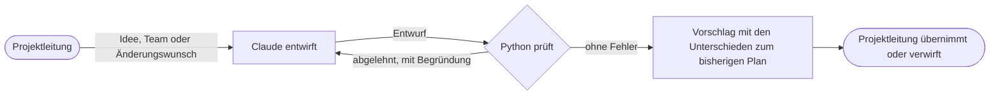
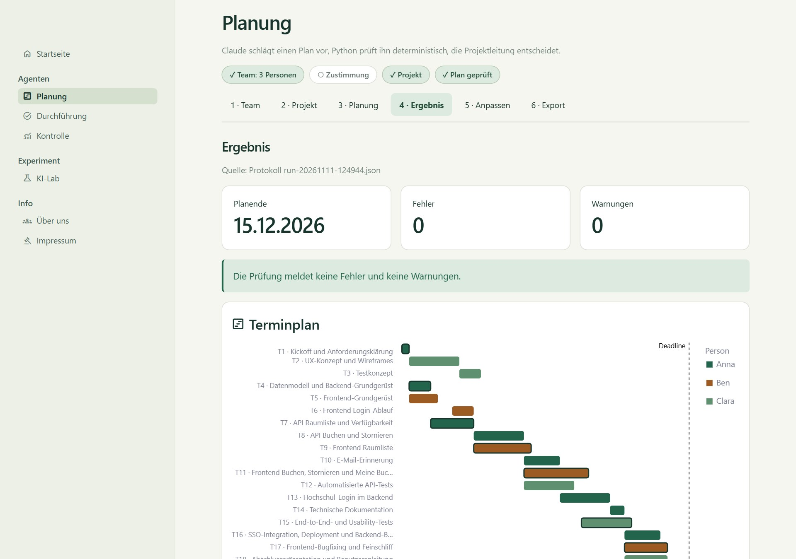
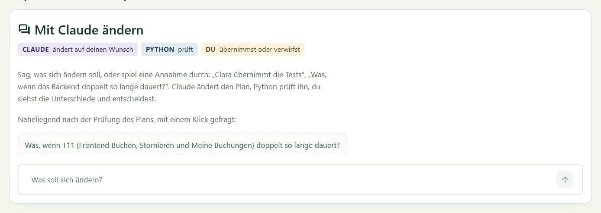

<div align="center">

# PM-Agent

**KI-gestütztes Projektmanagement · Projektgruppe 4 · HSBI, Modul IPM, Thema 4**

Claude schlägt vor. Python prüft nach. Die Projektleitung entscheidet.

[](https://github.com/minglu-prime/KI-gestuetztes-Projektmanagement/actions/workflows/pm-agent.yml)


[Worum es geht](#worum-es-geht) ·
[So arbeitet der Agent](#so-arbeitet-der-agent) ·
[Ein echter Lauf](#ein-echter-lauf) ·
[Die Website](#die-website) ·
[Schnellstart](#schnellstart) ·
[Stand und Grenzen](#stand-und-grenzen)


</div>

## Worum es geht

Untersuchung des Einflusses künstlicher Intelligenz auf Projektmanagementprozesse anhand einer
praxisorientierten Fallstudie mit Fokus auf Effizienz, Automatisierung und
Mensch-KI-Zusammenarbeit.

Die Fallstudie ist ein Softwareprojekt einer kleinen Gruppe. Der Prototyp in diesem Repository
zeigt daran, welche Aufgaben des klassischen Projektmanagements ein KI-Agent übernehmen kann,
und wo er es nicht sollte:

- **Planung:** Aufgaben schneiden, Aufwand schätzen, nach Skills und verfügbarer Zeit zuweisen,
  Termine und Risiken ableiten.
- **Durchführung:** den Stand zusammenfassen und nächste Schritte vorschlagen.
- **Kontrolle:** Plan und Ist vergleichen, Verzug bewerten, Gegenmaßnahmen vorschlagen.
- **Experiment:** im KI-Lab dieselbe Art von Planungsaufgabe einmal ohne und einmal mit
  KI-Hilfe bearbeiten, mit Zeitlimit und Protokoll.

## So arbeitet der Agent

Ein Sprachmodell rechnet nicht zuverlässig. Deshalb rechnet es hier nicht: Termine, Auslastung,
kritischer Pfad und Verzug kommen aus Python, und jedes Ergebnis von Claude geht durch eine
deterministische Prüfung, bevor ein Mensch es sieht.



- **Claude schlägt vor.** Der Agent bekommt Projektidee und Team und reicht einen Plan über ein
  Werkzeug ein. Freitext als Ergebnis gibt es nicht.
- **Python prüft.** `check_plan` terminiert den Plan und meldet Fehler (unbekannte Person,
  zyklische Abhängigkeit) und Warnungen (Deadline verpasst, kein Puffer, Überlastung, fehlender
  Skill). Ein Plan mit Fehlern wird abgelehnt und geht mit den Gründen zurück an Claude.
- **Der Mensch entscheidet.** Warnungen bleiben stehen, bis die Projektleitung sie gesehen hat.
  Auch die Unterschiede zwischen zwei Plänen berechnet Python, nicht Claude: Worüber entschieden
  wird, hängt nicht an der Zusammenfassung des Modells.

## Ein echter Lauf

So sah ein Planungslauf gegen die Claude API aus. Die Website zeigt jede Runde: was Claude
geändert hat und was die Prüfung darauf geantwortet hat.

| Runde | Claude | Prüfung |
|---|---|---|
| 1 | Erster Entwurf: 17 Aufgaben, 220 h | Planende 30.12., **8 Arbeitstage nach der Deadline** |
| 2 | Aufgaben neu geschnitten und neu verteilt: 18 Aufgaben, 214 h | Planende 22.12., noch **2 Arbeitstage zu spät** |
| 3 | Eine Abhängigkeit geändert | **0 Fehler, 0 Warnungen** |
| 4 | Risiken ergänzt, Plan eingereicht | Angenommen. Planende 15.12., drei Arbeitstage Puffer |

<sub>Lauf vom 11.11.2026: 4 Runden, 184 Sekunden, rund 52 000 Eingabe- und 23 000
Ausgabe-Token, Modell `claude-opus-5-5`. Projekt (Web-App zum Buchen von Lernräumen) und Team
(Anna, Ben, Clara) sind erfunden.</sub>

<div align="center">

</div>

## Die Website

Eine Streamlit-Anwendung mit dem Menü Startseite, Agenten (Planung, Durchführung, Kontrolle),
KI-Lab, Über uns und Impressum. Sie läuft nur auf dem eigenen Rechner.

### Planung

Sechs Schritte: Team, Projekt, Planung, Ergebnis, Anpassen, Export. Eine Leiste zeigt, was noch
fehlt, und jeder Schritt führt in den nächsten. Zum Team gehören Skills, Wochenstunden und
Abwesenheiten: An Tagen, an denen jemand fehlt, wird für die Person keine Arbeit eingeplant.

<div align="center">

</div>

Das Ergebnis zeigt Terminplan mit kritischem Pfad, Auslastung je Person, Risiken und die
Begründung jeder Zuweisung. Der Plan lässt sich als Markdown oder CSV exportieren und als
Projekt übernehmen.

Zu jeder Aufgabe gibt es die Antwort auf „Warum diese Person, und was hängt daran?“: Claudes
Begründung, die Stufe der Person in jedem verlangten Skill, was vorher fertig sein muss und was
darauf wartet, wie viele Arbeitstage Puffer die Aufgabe hat, und wer im Team sie sonst
übernehmen könnte. Nur die Begründung stammt von Claude, alles andere rechnet Python.

<div align="center">

</div>

### Den Plan im Gespräch ändern

Im Schritt Anpassen nimmt Claude einen Wunsch oder eine Annahme entgegen, zum Beispiel „Clara
übernimmt die Tests“ oder „Was, wenn das Backend doppelt so lange dauert?“. Das Ergebnis ist ein
Vorschlag mit den Unterschieden zum aktuellen Plan:

```text
A · Datenmodell: 8 h → 16 h
Planende: 11.11.2026 → 12.11.2026 (1 Arbeitstag später)
Termine von 2 Aufgaben verschieben sich
```

Erst „Übernehmen“ macht ihn gültig. Wer Claude nicht fragen will, ändert die Tabelle darunter
von Hand; dann läuft nur die Prüfung.

<div align="center">

</div>

### Durchführung und Kontrolle

Beide Seiten rechnen mit dem übernommenen Plan und dem erfassten Fortschritt (Status,
Ist-Stunden und, wo bekannt, der geschätzte Rest je Aufgabe). Die Durchführung füllt
Statusbericht und Arbeitspaketbeschreibungen aus Vorlagen. Die Kontrolle stellt Plan und Ist
gegenüber, nennt Aufgaben im Verzug und rechnet Kosten, sobald ein Stundensatz gesetzt ist. Auf
beiden Seiten macht ein Agent einen Vorschlag, den Python nur annimmt, wenn er jede Aufgabe im
Verzug behandelt.

Die Kontrolle sagt auch, was ein Verzug bedeutet. Die **Prognose** plant alles, was noch nicht
fertig ist, ab heute neu ein und vergleicht das Ende mit Plan und Deadline. Im Beispiel unten
sind zwei Aufgaben ein bis zwei Tage im Verzug; die Folge ist ein Ende vier Arbeitstage nach
Plan und einen Tag nach der Deadline.

<div align="center">

</div>

### KI-Lab

Ein eigener kleiner Server für den kontrollierten Vergleich: zwei Planungsfälle, einer ohne und
einer mit KI-Hilfe, je 25 Minuten, mit Protokoll und Auswertung. Die Website startet ihn und
bettet ihn ein. Das KI-Lab nutzt die OpenAI API und braucht nur die Python-Standardbibliothek.
Mehr dazu in [`04-Prototyp/ki_lab`](04-Prototyp/ki_lab/README.md).

## Schnellstart

Voraussetzung: [uv](https://docs.astral.sh/uv/) und Python 3.11 oder neuer.

```bash
cd 04-Prototyp/pm_agent
uv sync
cp .env.example .env        # ANTHROPIC_API_KEY eintragen
uv run --env-file .env streamlit run app.py
```

Dann `http://localhost:8501` öffnen.

Ohne API-Schlüssel startet die Website ebenfalls (`uv run streamlit run app.py`). Die Agenten
melden dann, dass der Zugang fehlt; es gibt keine Demo-Antworten. Protokolle früherer Läufe
liegen nur lokal in `logs/` und nicht im Repository.

Prüfen:

```bash
uv run ruff check .
uv run pytest
```

Alle Tests laufen ohne Netz gegen eine nachgestellte API. Der eine Test gegen die echte API
überspringt sich ohne Schlüssel.

Einzelheiten zu Seiten, Agenten und Entwicklung:
[`04-Prototyp/pm_agent`](04-Prototyp/pm_agent/README.md).

## Aufbau des Repositorys

| Ordner | Inhalt | Stand |
|---|---|---|
| `01-Projektplanung` | Projektplan der Gruppe | noch leer |
| `02-Recherche` | Recherche zu KI im Projektmanagement | noch leer |
| `03-Experiment` | Aufbau und Daten des Vergleichs | noch leer |
| [`04-Prototyp/pm_agent`](04-Prototyp/pm_agent) | die Website mit den drei Agenten | in Arbeit |
| [`04-Prototyp/ki_lab`](04-Prototyp/ki_lab) | Studienserver für den Vergleich ohne und mit KI | in Arbeit |
| `05-Ergebnisse` | Auswertung und Bericht | noch leer |

`Projekte Aufgaben` im Wurzelverzeichnis ist das Material aus der Lehrveranstaltung.

## Stand und Grenzen

| Teil | Stand |
|---|---|
| Erster Plan mit Claude | gegen die echte API gelaufen (Protokoll vom 11.11.2026) |
| Plan im Gespräch ändern | gebaut und ohne Netz getestet; **noch nicht gegen die echte API gelaufen** |
| Agenten für Durchführung und Kontrolle | Gerüst mit je einem Werkzeug und einer Prüfung; **noch nicht gegen die echte API gelaufen** |
| KI-Lab | eingebettet; Runden ohne KI funktionieren, KI-Runden sind ohne Schlüssel nicht geprüft |
| Vergleich mit Versuchspersonen | steht aus |

Was der Prototyp bewusst vereinfacht:

- **Kalender:** Arbeitstage Montag bis Freitag. Abwesenheiten trägt die Projektleitung je
  Person ein; an diesen Tagen wird keine Arbeit eingeplant. Feiertage kennt der Kalender
  nicht: Sie lassen sich als Abwesenheit bei allen Personen eintragen.
- **Arbeit:** eine Person arbeitet an einer Aufgabe zur selben Zeit; eine Aufgabe gehört einer
  Person.
- **Terminierung:** Aufgaben werden in der Reihenfolge ihrer Abhängigkeiten eingeplant, nicht
  optimiert. Ein Plan kann deshalb länger ausfallen als nötig.
- **Prognose:** Die restliche Arbeit beginnt heute und läuft in der Reihenfolge des Plans.
  Ohne eingetragenen Rest zählt eine begonnene Aufgabe mit Schätzung minus Ist-Stunden.
- **Kosten:** Stunden mal Stundensatz. Token-Kosten der Agenten werden gezählt, aber nicht in
  Euro umgerechnet.

## Datenschutz

Das Repository ist öffentlich. Teamdaten (`data/`), Protokolle (`logs/`), Sitzungen des KI-Labs
und `.env` bleiben lokal und sind per `.gitignore` ausgeschlossen.

Die Agenten schicken Projektidee und Teamdaten (Namen, Skills, Wochenstunden, Notizen) an die
Anthropic API, das KI-Lab schickt in KI-Runden Fallmaterial, Entwurf und Frage an OpenAI. Die
Website verlangt deshalb vor jedem Aufruf die Bestätigung, dass alle Personen zugestimmt haben.
Die Namen der Gruppe stehen erst im Repository, wenn alle zugestimmt haben.
