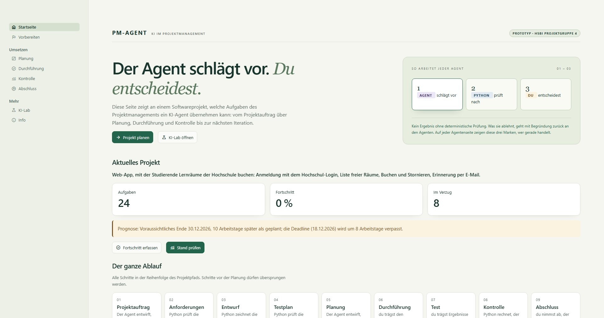
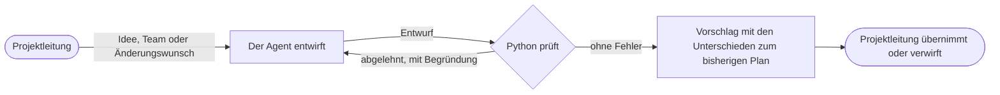
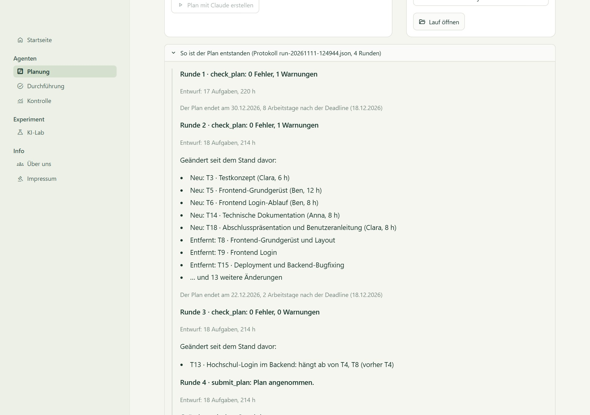
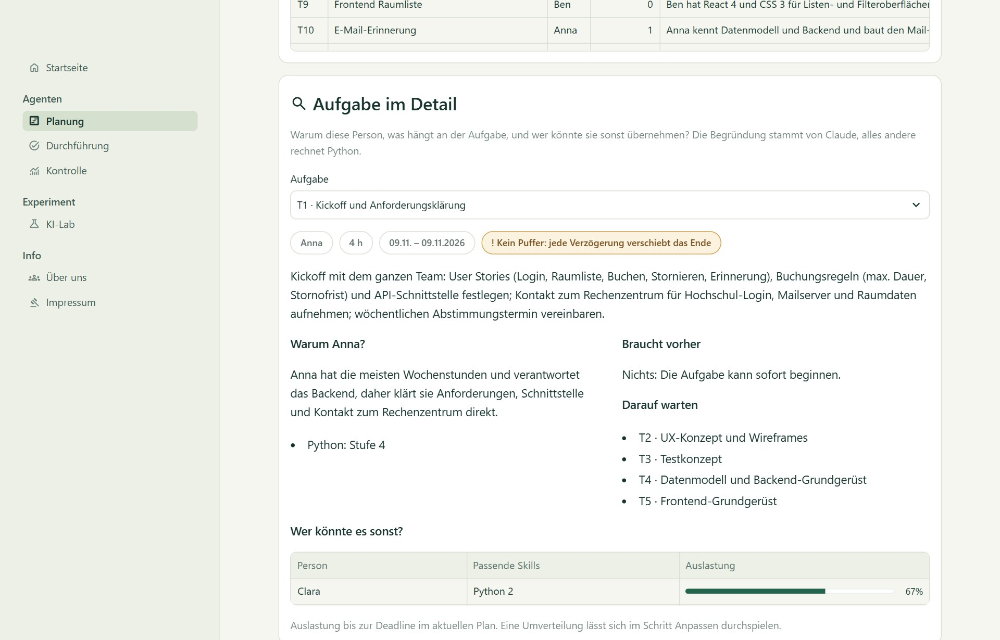
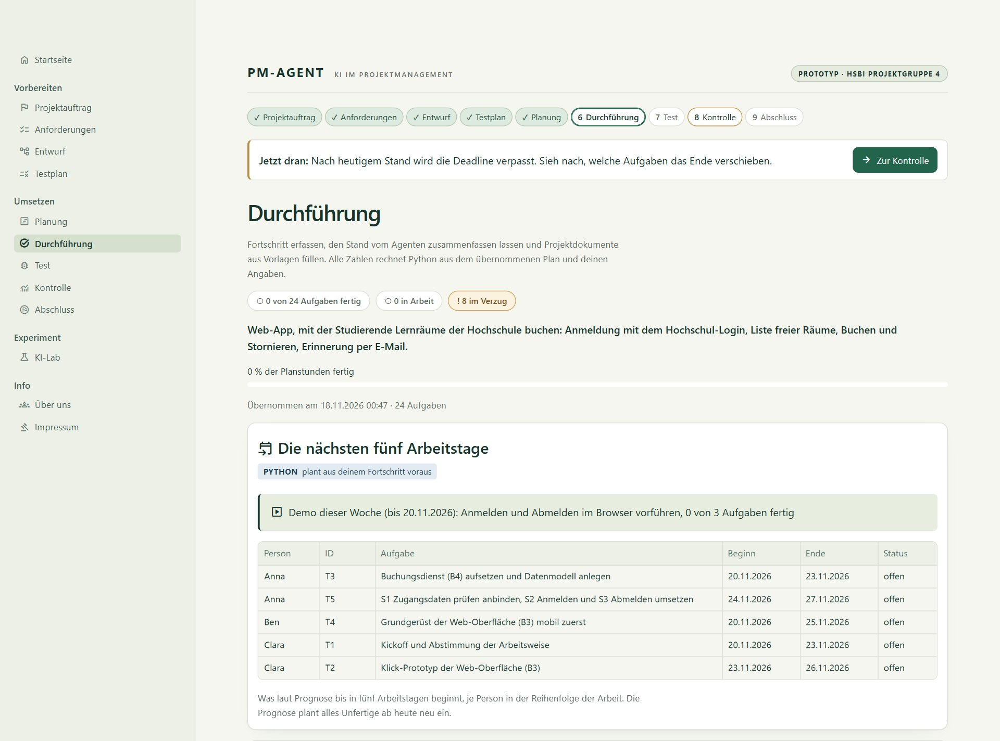
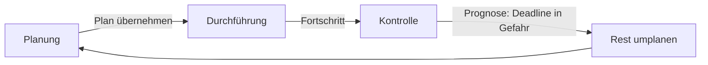
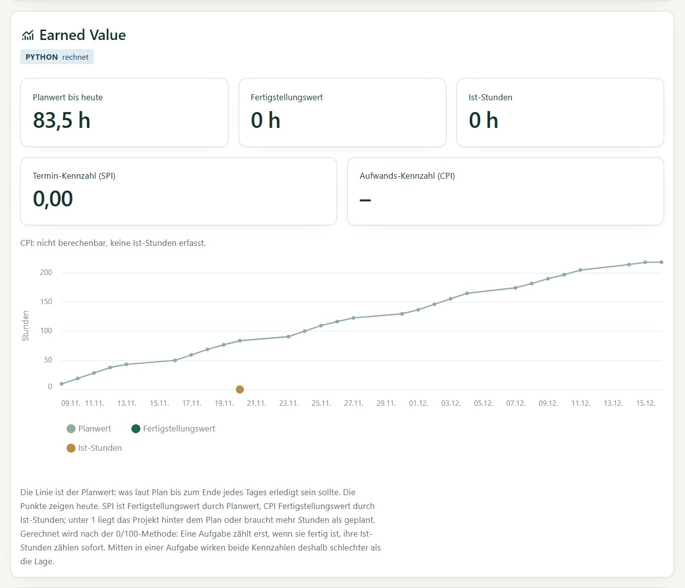
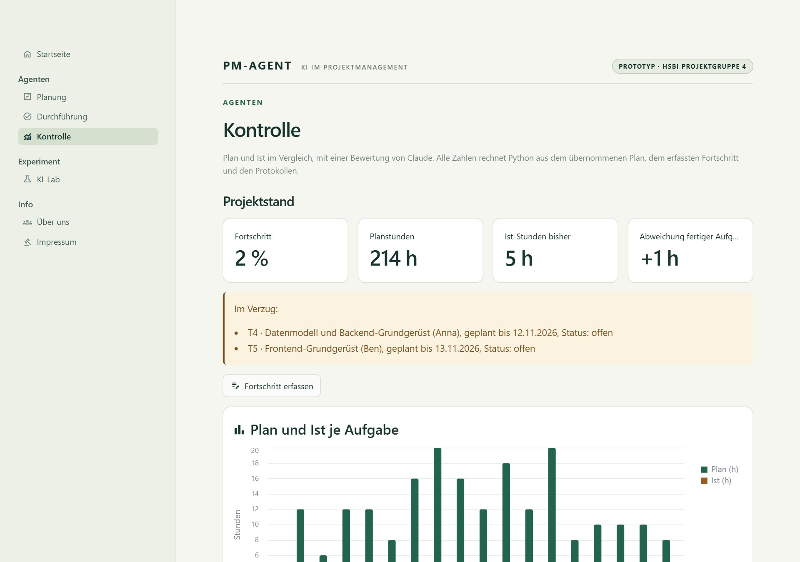

<div align="center" markdown="1">

# PM-Agent

**KI-gestütztes Projektmanagement · Projektgruppe 4 · HSBI, Modul IPM, Thema 4**

Der Agent schlägt vor. Python prüft nach. Die Projektleitung entscheidet.

[](https://github.com/minglu-prime/KI-gestuetztes-Projektmanagement/actions/workflows/pm-agent.yml)


[Worum es geht](#worum-es-geht) ·
[So arbeitet der Agent](#so-arbeitet-der-agent) ·
[Ein echter Lauf](#ein-echter-lauf) ·
[Die Website](#die-website) ·
[Schnellstart](#schnellstart) ·
[Stand und Grenzen](#stand-und-grenzen)



</div>

## Worum es geht

Untersuchung des Einflusses künstlicher Intelligenz auf Projektmanagementprozesse anhand einer
praxisorientierten Fallstudie mit Fokus auf Effizienz, Automatisierung und
Mensch-KI-Zusammenarbeit.

Die Fallstudie ist ein Softwareprojekt einer kleinen Gruppe. Der Prototyp in diesem Repository
zeigt daran, welche Aufgaben des klassischen Projektmanagements ein KI-Agent übernehmen kann,
und wo er es nicht sollte:

- **Planung:** Aufgaben schneiden, Aufwand schätzen, nach Skills und verfügbarer Zeit zuweisen,
  Termine und Risiken ableiten.
- **Durchführung:** den Stand zusammenfassen und nächste Schritte vorschlagen.
- **Kontrolle:** Plan und Ist vergleichen, Verzug bewerten, Gegenmaßnahmen vorschlagen.
- **Davor und danach:** Projektauftrag, Anforderungen, Entwurf und Testplan vor der Planung;
  Test, Abschluss mit Lessons Learned, Betrieb und der nächste Durchlauf danach. Jeder Schritt
  folgt demselben Muster wie die Planung.
- **Experiment:** im KI-Lab dieselbe Art von Planungsaufgabe einmal ohne und einmal mit
  KI-Hilfe bearbeiten, mit Zeitlimit und Protokoll.

## So arbeitet der Agent

Ein Sprachmodell rechnet nicht zuverlässig. Deshalb rechnet es hier nicht: Termine, Auslastung,
kritischer Pfad und Verzug kommen aus Python, und jedes Ergebnis vom Agenten geht durch eine
deterministische Prüfung, bevor ein Mensch es sieht.



- **Der Agent schlägt vor.** Der Agent bekommt Projektidee und Team und reicht einen Plan über ein
  Werkzeug ein. Freitext als Ergebnis gibt es nicht.
- **Python prüft.** `check_plan` terminiert den Plan und meldet Fehler (unbekannte Person,
  zyklische Abhängigkeit) und Warnungen (Deadline verpasst, kein Puffer, Überlastung, fehlender
  Skill). Ein Plan mit Fehlern wird abgelehnt und geht mit den Gründen zurück an den Agenten.
- **Der Mensch entscheidet.** Warnungen bleiben stehen, bis die Projektleitung sie gesehen hat.
  Auch die Unterschiede zwischen zwei Plänen berechnet Python, nicht der Agent: Worüber entschieden
  wird, hängt nicht an der Zusammenfassung des Modells.

## Ein echter Lauf

So sah ein Planungslauf gegen die Claude API aus. Die Website zeigt jede Runde: was der Agent
geändert hat und was die Prüfung darauf geantwortet hat.

| Runde | Agent | Prüfung |
|---|---|---|
| 1 | Erster Entwurf: 17 Aufgaben, 220 h | Planende 30.12., **8 Arbeitstage nach der Deadline** |
| 2 | Aufgaben neu geschnitten und neu verteilt: 18 Aufgaben, 214 h | Planende 22.12., noch **2 Arbeitstage zu spät** |
| 3 | Eine Abhängigkeit geändert | **0 Fehler, 0 Warnungen** |
| 4 | Risiken ergänzt, Plan eingereicht | Angenommen. Planende 15.12., drei Arbeitstage Puffer |

<sub>Lauf vom 11.11.2026: 4 Runden, 184 Sekunden, rund 52 000 Eingabe- und 23 000
Ausgabe-Token, Modell `claude-opus-5-5`. Projekt (Web-App zum Buchen von Lernräumen) und Team
(Anna, Ben, Clara) sind erfunden.</sub>

<div align="center">

</div>

## Die Website

Eine Streamlit-Anwendung, die nur auf dem eigenen Rechner läuft. Das Menü folgt dem Ablauf eines
Softwareprojekts und hat acht Einträge: Startseite; Vorbereiten; Planung, Durchführung, Kontrolle,
Abschluss; KI-Lab; Info. Vorbereiten öffnet Projektauftrag, Anforderungen, Entwurf und Testplan
als Reiter über der Seite, Kontrolle ebenso den Test, Info Über uns und Impressum. Betrieb und
der nächste Durchlauf sind Reiter im Abschluss. Über jeder dieser
Seiten steht der Projektpfad mit allen neun Schritten und darunter, was als Nächstes zu tun ist
(außer auf der Seite, zu der es führt). Die Screenshots zeigen das erfundene
Beispielprojekt vom 20.11.2026.

Das ist die Ansicht der Projektleitung. Über dem Menü wechselt „Ansicht“ zur Ansicht Team: Wer
unter „Ich bin“ seinen Namen wählt, trägt in „Mein Bereich“ seine Fähigkeiten, Stunden und
Abwesenheiten ein und den Stand seiner Aufgaben; „Projektstand“ zeigt allen, wo das Projekt
steht. Die Leitung sieht Team und Fortschritt, ändert sie aber nicht. Eine Anmeldung gibt es
nicht: Die Ansicht ordnet die Seiten, sie schützt keine Daten.

### Planung

Sechs Schritte: Team, Projekt, Planung, Ergebnis, Anpassen, Übernehmen. Eine Leiste zeigt, was noch
fehlt, und jeder Schritt führt in den nächsten. Zum Team gehören Skills, Wochenstunden und
Abwesenheiten: An Tagen, an denen jemand fehlt, wird für die Person keine Arbeit eingeplant.
Nennt ein Änderungswunsch eine neue Abwesenheit, nimmt Python keinen Plan an, den sie hinter die
Deadline schiebt: Der Agent muss Aufgaben an andere im Team geben. Fehlen dem ganzen Team bis
zur Deadline die Stunden, nimmt Python den Plan an, und die Warnung nennt Stunden und das
früheste mögliche Ende. Kein Puffer oder fehlende Skills bleiben Warnungen.

<div align="center">

</div>

Das Ergebnis zeigt Terminplan mit kritischem Pfad, Auslastung je Person, Risiken und die
Begründung jeder Zuweisung. Der Plan lässt sich als Markdown oder CSV exportieren und als
Projekt übernehmen.

Zu jeder Aufgabe gibt es die Antwort auf „Warum diese Person, und was hängt daran?“: die Begründung
des Agenten, die Stufe der Person in jedem verlangten Skill, was vorher fertig sein muss und was
darauf wartet, wie viele Arbeitstage Puffer die Aufgabe hat, und wer im Team sie sonst
übernehmen könnte. Nur die Begründung stammt vom Agenten, alles andere rechnet Python.

<div align="center">

</div>

### Den Plan im Gespräch ändern

Im Schritt Anpassen nimmt der Agent einen Wunsch oder eine Annahme entgegen, zum Beispiel „Clara
übernimmt die Tests“ oder „Was, wenn das Backend doppelt so lange dauert?“. Das Ergebnis ist ein
Vorschlag mit den Unterschieden zum aktuellen Plan:

```text
A · Datenmodell: 8 h → 16 h
Planende: 11.11.2026 → 12.11.2026 (1 Arbeitstag später)
Termine von 2 Aufgaben verschieben sich
```

Erst „Übernehmen“ macht ihn gültig. Wer den Agenten nicht fragen will, ändert die Tabelle darunter
von Hand; dann läuft nur die Prüfung.

Was sich zu fragen lohnt, leitet Python aus der Prüfung ab und bietet es als Schaltfläche an:
den Plan bis zur Deadline enden lassen, eine überlastete Person entlasten, eine Aufgabe jemandem
geben, der den verlangten Skill hat, eine kritische Aufgabe vor eine unkritische derselben
Person ziehen, oder durchspielen, was passiert, wenn die längste Aufgabe auf dem kritischen
Pfad doppelt so lange dauert.

<div align="center">

</div>

### Durchführung und Kontrolle

Beide Seiten rechnen mit dem übernommenen Plan und dem Fortschritt, den jedes Teammitglied in
seinem Bereich einträgt (Status, Ist-Stunden und, wo bekannt, der geschätzte Rest je Aufgabe). Die Durchführung füllt
Statusbericht und Arbeitspaketbeschreibungen aus Vorlagen. Die Kontrolle stellt Plan und Ist
gegenüber, nennt Aufgaben im Verzug und rechnet Kosten, sobald ein Stundensatz gesetzt ist. Sie
ordnet das in sechs Reiter (Stand, Prognose, Plan und Ist, Kennzahlen, Demos, Agent und Bericht)
und öffnet den, der die Ergebniszeile erklärt. Auf
beiden Seiten macht ein Agent einen Vorschlag, den Python nur annimmt, wenn er jede Aufgabe im
Verzug behandelt.

Die Kontrolle sagt auch, was ein Verzug bedeutet. Die **Prognose** plant alles, was noch nicht
fertig ist, ab heute neu ein und vergleicht das Ende mit Plan und Deadline. Im Beispiel unten
ist noch kein Fortschritt erfasst, acht Aufgaben sind über ihr geplantes Ende; die Folge ist ein
Ende neun Arbeitstage nach Plan und sieben Arbeitstage nach der Deadline. Die Fortschrittstabelle der Durchführung zeigt dasselbe je
Aufgabe: „Prognose Ende“ neben dem geplanten Ende. Darüber steht, was daraus für die Woche folgt:
wer in den nächsten fünf Arbeitstagen womit beginnt.

<div align="center">

</div>

Von dort geht es zurück in die Planung: „Rest mit dem Agenten umplanen“ lädt die unfertigen Aufgaben
als Plan ab heute, und das Gespräch mit dem Agenten beginnt mit genau dem Problem, das die Prognose
gezeigt hat. Wer den neuen Plan übernimmt, wählt, ob die bisherige Arbeit erhalten bleibt: Fertige
Aufgaben und gebuchte Stunden zählen dann als frühere Arbeit in allen Kennzahlen und Berichten
weiter.



Schlägt der Kontroll-Agent vor, Aufgaben einer anderen Person zu geben, rechnet Python nach, was
das für das voraussichtliche Ende bedeutet. Das Ergebnis steht neben der Wirkung, die der Agent
erwartet. Maßnahmen ohne Umverteilung sind als nicht nachrechenbar markiert.

Dazu kommt die **Earned-Value-Analyse** nach der 0/100-Methode: Planwert bis heute,
Fertigstellungswert und Ist-Stunden, daraus SPI und CPI, mit der Kurve des Planwerts über die
Laufzeit.

<div align="center">

</div>

Alles zusammen gibt es als **Kontrollbericht**: ein Markdown-Dokument aus einer Vorlage mit
Kennzahlen, Prognose, Verzug, Kosten und, wenn erstellt, der Bewertung des Agenten samt
nachgerechneter Wirkung.

Auf den vier Hauptseiten **Planung**, **Durchführung**, **Kontrolle** und **Abschluss** lässt sich
optional ein kurzer strukturierter **Effizienzvergleich (mit vs. ohne Agent)** ausfüllen
(Zeitaufwand, Qualität, Arbeitsbelastung, phasenspezifischer Nutzen). Python verknüpft die Antworten
mit dem letzten gültigen Agentenlauf der Phase und schreibt sie lokal nach `logs/agent_vergleich.csv`;
die Seite Kontrolle (Reiter „Agent und Bericht“) fasst alle vier Phasen zusammen und bietet einen
CSV-Export. Die Bewertung ergänzt das kontrollierte KI-Lab um subjektive Eindrücke aus dem
Arbeitsablauf.

<div align="center">

</div>

### KI-Lab

Ein eigener kleiner Server für den kontrollierten Vergleich: zwei Planungsfälle, einer ohne und
einer mit KI-Hilfe, je 25 Minuten, mit Protokoll und Auswertung. Die Website startet ihn und
bettet ihn ein. Das KI-Lab nutzt die OpenAI-kompatible Schnittstelle (über `OPENAI_BASE_URL`) und
braucht nur die Python-Standardbibliothek. Mehr dazu in
[`04-Prototyp/ki_lab`](04-Prototyp/ki_lab/README.md).

## Schnellstart

Voraussetzung: [uv](https://docs.astral.sh/uv/) und Python 3.11 oder neuer.

```bash
cd 04-Prototyp/pm_agent
uv sync
cp .env.example .env        # OPENAI_API_KEY, OPENAI_BASE_URL (für KI:connect) und PM_AGENT_MODEL eintragen
uv run --env-file .env streamlit run app.py
```

Dann `http://localhost:8501` öffnen.

Ohne API-Schlüssel startet die Website ebenfalls (`uv run streamlit run app.py`). Die Agenten
melden dann, dass der Zugang fehlt; es gibt keine Demo-Antworten. Protokolle früherer Läufe
liegen nur lokal in `logs/` und nicht im Repository.

Prüfen:

```bash
uv run ruff check .
uv run pytest
```

Alle Tests laufen ohne Netz gegen eine nachgestellte API. Der eine Test gegen die echte API
überspringt sich ohne Schlüssel.

Einzelheiten zu Seiten, Agenten und Entwicklung:
[`04-Prototyp/pm_agent`](04-Prototyp/pm_agent/README.md).

## Aufbau des Repositorys

| Ordner | Inhalt | Stand |
|---|---|---|
| [`01-Projektplanung`](01-Projektplanung) | Projektplan, [Entscheidungen](01-Projektplanung/entscheidungen.md) und [offene Entscheidungen als Agenda](01-Projektplanung/agenda-entscheidungen.md) | Entscheidungslog begonnen (E01, 21.11.2026); Agenda als Entwurf |
| [`02-Recherche`](02-Recherche) | Recherche zu KI im Projektmanagement: [Baseline](02-Recherche/baseline.md), [KI-Lösungen](02-Recherche/ki-loesungen.md), [Chancen und Risiken](02-Recherche/chancen-risiken.md), [Literaturregister](02-Recherche/literaturregister.md), [Suchprotokoll](02-Recherche/suchprotokoll.md) | Entwürfe (20 Quellen, 13 im Volltext), von der Gruppe zu bestätigen |
| [`03-Experiment`](03-Experiment) | Aufbau und Daten der Versuche: [Versuchsdesign](03-Experiment/versuchsdesign.md), [Pilot-Checkliste](03-Experiment/pilot-checkliste.md), [Bewertungsrubrik](03-Experiment/bewertungsrubrik.md), [Teilnahmeinformation](03-Experiment/teilnahmeinformation.md), [Durchführungsprotokoll](03-Experiment/durchfuehrungsprotokoll.md) | Entwürfe, von der Gruppe zu bestätigen; erster Agentenlauf (21.11.2026) |
| [`04-Prototyp/pm_agent`](04-Prototyp/pm_agent) | die Website mit allen Schritten vom Projektauftrag bis zur Iteration | in Arbeit |
| [`04-Prototyp/ki_lab`](04-Prototyp/ki_lab) | Studienserver für den Vergleich ohne und mit KI | in Arbeit |
| [`05-Ergebnisse`](05-Ergebnisse) | Auswertung und Bericht: [Berichtsvorlage](05-Ergebnisse/berichtsvorlage.md) | Vorlage als Entwurf; noch keine Ergebnisse |

`Projekte Aufgaben` im Wurzelverzeichnis ist das Material aus der Lehrveranstaltung.

## Stand und Grenzen

| Teil | Stand |
|---|---|
| Wechsel zur OpenAI API (20./21.11.2026) | Agenten rufen die OpenAI Responses API auf (mit Reasoning). Am 20. und 21.11.2026 liefen alle elf Agenten und eine KI-Runde des KI-Labs je einmal ohne Fehler gegen den OpenAI-kompatiblen Endpunkt der Hochschule (`gpt-6-sol`), am 21.11. mit Längengrenzen für Freitexte ([Auswertung](03-Experiment/agentenlauf-2026-11-21/README.md)) |
| Umplanung und Durchführung (23.11.2026) | je dreimal gegen `gpt-6-sol`: Die Zusammenfassung nennt das Enddatum der Prognose in 3 von 3 Läufen; die Umplanung verteilt bei einer Abwesenheit nur in 2 von 3 Läufen um, dann ohne Puffer und mit fehlenden Fähigkeiten ([Auswertung](03-Experiment/agentenlauf-2026-11-23/README.md)) |
| Erster Plan mit dem Agenten | gegen die Claude API gelaufen (Protokolle vom 11.11. und 18.11.2026) |
| Frühere Läufe | am 18.11.2026 je einmal ohne Fehler gegen die Claude API: alle Agenten außer der Abwesenheit aus einem Wunsch |
| KI-Lab | eingebettet; Ablauf, Zeitlimit und Export im Browser geprüft, eine KI-Runde gegen den OpenAI-kompatiblen Endpunkt lief am 20.11.2026 ([Prüfprotokoll](04-Prototyp/ki_lab/VERIFIKATION.md)) |
| Vergleich mit Versuchspersonen | steht aus |

Was der Prototyp bewusst vereinfacht:

- **Kalender:** Arbeitstage Montag bis Freitag. Persönliche Abwesenheiten trägt jedes
  Teammitglied selbst in „Mein Bereich“ (Ansicht Team) ein; an diesen Tagen wird für die Person
  keine Arbeit eingeplant. Feiertage kennt der Kalender
  nicht von selbst: Die Projektleitung trägt sie beim Projekt als freie Tage für alle ein.
  Puffer und Verspätung zur Deadline zählen in Arbeitstagen des Projekts, also ohne diese
  freien Tage; Abwesenheiten einzelner Personen zählen dabei mit.
- **Arbeit:** eine Person arbeitet an einer Aufgabe zur selben Zeit; eine Aufgabe gehört einer
  Person.
- **Terminierung:** Als Nächstes wird eingeplant, was am frühesten beginnen kann; bei
  Gleichstand, was im Plan weiter oben steht. Niemand wartet auf eine Aufgabe, solange eine
  andere von ihm laufen könnte. Das ist eine Regel, keine Optimierung: Ein Plan kann länger
  ausfallen als nötig.
- **Prognose:** Die restliche Arbeit beginnt heute und wird nach derselben Regel eingeplant,
  bei Gleichstand Begonnenes vor Offenem. Ein Projekt genau im Plan bekommt deshalb seinen
  Plan als Prognose, und
  „Rest mit dem Agenten umplanen“ zeigt in der Planung dasselbe Ende wie die Prognose.
  Ohne eingetragenen Rest zählt eine begonnene Aufgabe mit Schätzung minus Ist-Stunden.
- **Kosten:** Stunden mal Stundensatz. Token-Kosten der Agenten werden gezählt, aber nicht in
  Euro umgerechnet.

## Datenschutz

Das Repository ist öffentlich. Teamdaten (`data/`), Protokolle (`logs/`), Sitzungen des KI-Labs
und `.env` bleiben lokal und sind per `.gitignore` ausgeschlossen.

Die Agenten schicken Projektidee und Teamdaten (Namen, Skills, Wochenstunden, Abwesenheiten,
Notizen) an den KI-Dienst in `OPENAI_BASE_URL` (in diesem Projekt der OpenAI-kompatible Endpunkt
der Hochschule),
das KI-Lab schickt in KI-Runden Fallmaterial, Entwurf und Frage an denselben Dienst. Die Website
verlangt deshalb vor jedem Aufruf die Bestätigung, dass alle Personen zugestimmt haben; der Text
nennt den Dienst.
Die Namen der Gruppe stehen erst im Repository, wenn alle zugestimmt haben.
